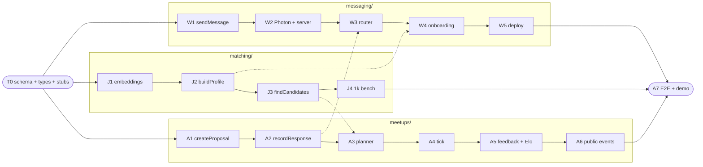

# mixr Plan

The team plan for the hackathon MVP. Every task, test, and exact interface is in [`docs/superpowers/plans/2026-10-17-mixr-mvp.md`](docs/superpowers/plans/2026-10-17-mixr-mvp.md). This page is the overview.

## Integration status (branch `integration`, 2026-10-17)

The `integration` branch replaces the original SQLite meetups/matching design with John's simulator build and ports Wayne's messaging layer onto it. What changed versus the plan below:

| Area | Original plan | Now |
|---|---|---|
| Events | Planner auto-proposes meetups from availability slots | Students host events by text; mixr invites the right people in hidden rounds (HyDE + Rocchio), RSVPs in natural language |
| Matching | One vector per interest, cosine + Elo | One vector per person (canonical profile text), pgvector recall top 40 → Claude rerank; blocks and special requests enforced before ranking |
| DB | `node:sqlite` | PGlite (embedded Postgres + pgvector) |
| LLM | Haiku for extraction | Claude Haiku 5.5 for the agent and pipeline (1000 req/day cap); OpenAI embeddings |
| Messaging | Photon webhook | Wayne's Spectrum gRPC adapter, consent, UW email codes, STOP/START, outbox (ported) |
| Join | Text a shared number | Website registers the phone with Photon (shared line) and shows the person's own number; they text first |
| Hosting | Railway | Monolith on polarcrest (systemd, auto-restart, health watchdog, nightly snapshots); Railway later, maybe |
| Demo | Seeded data | 50 hand-written demo students in a separate pool; dashboard can act as any user |

Live: `https://mixr-api.johnomeara.com` (dashboard at `/dashboard`). Landing preview: Vercel builds `integration` as a preview; `main` deploys joinmixr.club.

- [x] Auto-deploy: polarcrest ships each new commit on `main` within ~2 minutes once its tests, typecheck and dashboard build pass on the box, and rolls back if `/health` fails (`deploy/release.sh`, `mixr-autodeploy.timer`)
- [x] CI on every PR and on pushes to `main`/`integration` (`.github/workflows/ci.yml`); team workflow in [CONTRIBUTING.md](CONTRIBUTING.md)
- [x] Point `api.joinmixr.club` at the tunnel (Cloudflare for SaaS)
- [x] Merge `integration` → `main` (ships the landing page; main is production)
- [ ] Live multi-phone run-through
- [ ] Photon plan upgrade if we need more than 10 users

## MVP goal

A student texts their interests, gets a compatible 1:1 or small-group proposal, accepts a time and place, and receives a confirmed meetup. No human organizer is involved.

## Spec graph

Solid arrows are the order within a module. Dotted arrows are cross-module dependencies. Until a real implementation lands, use the T0 stubs.

## Team & ownership

The work is split by system responsibility, so the "people" and "events" paths share components instead of becoming two products.

| Module | Owner | Folder | Tasks | Boundary |
|---|---|---|---|---|
| Contract (schema, types) | John leads, all review | `src/types.ts`, `src/db.ts`, `src/schema.sql` | T0 | Changes need all 3 to agree |
| Messaging | **Wayne** | [`src/messaging/`](src/messaging/README.md), `src/server.ts`, `scripts/chat.ts` | W1–W6 | Owns conversation and transport. Not matching or scheduling |
| Matching | **John** | [`src/matching/`](src/matching/README.md), `scripts/seed.ts` | J1–J4 | Ranks candidates. Not availability, consent, or confirmation |
| Meetups | **Aditya** | [`src/meetups/`](src/meetups/README.md), `test/e2e.test.ts` | A1–A7 | Owns event state and scheduling. Not delivery or embeddings |

## Interfaces (agree before coding)

| Function | Owner | Does |
|---|---|---|
| `buildProfile(userId, text)` | John | Structured profile for the user to confirm |
| `findCandidates(criteria)` | John | Eligible users with scores and grounded reasons |
| `createProposal(details)` | Aditya | Meetup with time, place, capacity, and deadline. Sends invites |
| `recordResponse(userId, proposalId, reply)` | Aditya | Updates participation and confirmation. Never overfills |
| `sendMessage(userId, text, dedupeKey)` | Wayne | Sends once and records the delivery outcome |

The exact types are defined in plan Task T0.

## Timeline

| Stage | Wayne | John | Aditya | Milestone |
|---|---|---|---|---|
| Hour 1 | Photon access spike | **T0** schema, types, stubs | Meetup states, invite copy | Interfaces agreed |
| First slice | W1, W2 | J1 + mock candidates | A1, A2 | Two phones complete an invite |
| Core | W3, W4 | J2, J3 | A3, A4 | Real onboarding → real proposal |
| Integration | STOP/dup tests | J4 tuning | A5, A6 | Pair + group scenarios pass |
| Final | W5 deploy | J4 bench | **A7** E2E + demo | Repeatable demo |

## Definition of done

Three or more opted-in testers can onboard, get a relevant group proposal, accept it, and receive the same confirmed details. A decline, a duplicate message, or a late acceptance never creates a wrong confirmation or overfills the event. The 1,000-profile matching benchmark is shown separately from live messaging capacity.

## Deferred

Each of these gets a GitHub issue labeled `later`, and nobody builds them until A7 passes: calendar sync, dorm/roommate matching, parties and club management, Luma hosting, voice braindumps, social-graph visualization and friend-of-friend scoring, location grouping, native group chats, the website, and LLM-written match explanations.
