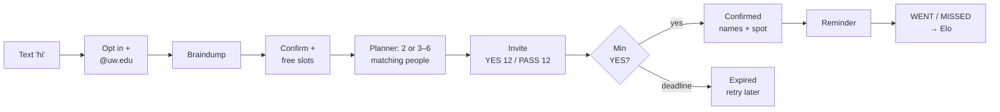
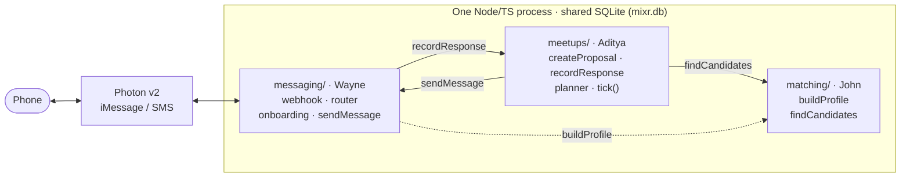

# mixr

**A campus organizer you can text.** Text mixr what you're into. It finds other UW students who want the same thing, proposes a specific time and public place, and confirms the meetup once enough people say yes. Nobody has to make flyers or herd a group chat.

> Most matching apps stop at "you two should hang out sometime." mixr does the organizing work after that: availability, minimum headcount, cancellations, reminders, and follow-up.

## The loop (MVP)



## Architecture



- **Matching** = hard filters (availability, mode, opted-in, not busy) → cosine similarity over **one vector per interest**, so a philosophy + soccer person can join either group → greedy group selection against a running centroid.
- **Event vectors learn:** each time someone accepts, the meetup's embedding moves toward the average of the people who said yes (`0.5·seed + 0.5·mean(accepted)`).
- **Reliability** is an Elo rating: WENT raises it and MISSED lowers it. It slightly weights candidate ranking.
- Similarity **ranks** candidates. It is not a "personality compatibility" score.

## Stack

| Concern | Choice | Why |
|---|---|---|
| Runtime | Node ≥ 24, TypeScript via native type-stripping | No build step |
| DB | `node:sqlite`, one file | 1,000 users × 384 floats ≈ 1.5 MB. No server needed |
| Tests | `node:test` | Built in |
| Messaging | Photon v2 (iMessage/SMS) | Hackathon track fit |
| Extraction | `@anthropic-ai/sdk`, `claude-haiku-5-5` | Braindump → structured profile |
| Embeddings | `@huggingface/transformers`, `all-MiniLM-L6-v2` | Local, free, 384-dim |

## Repo layout & owners

| Path | Owner | What |
|---|---|---|
| `src/types.ts`, `src/db.ts`, `src/schema.sql` | John (all review) | **The shared contract.** Changes need all 3 to agree |
| [`src/messaging/`](src/messaging/README.md), `src/server.ts`, `scripts/chat.ts` | **Wayne** | Photon, webhook, router, onboarding, delivery, deploy |
| [`src/matching/`](src/matching/README.md), `scripts/seed.ts` | **John** | Profile extraction, embeddings, candidates, 1k bench |
| [`src/meetups/`](src/meetups/README.md), `test/e2e.test.ts` | **Aditya** | Proposals, responses, planner, scheduler, Elo, demo |
| `test/` | Each owner | Tests mirror `src/` folders |
| [`docs/superpowers/plans/2026-10-17-mixr-mvp.md`](docs/superpowers/plans/2026-10-17-mixr-mvp.md) | All | **The plan.** Every task, interface, and test |

## Interfaces (agree before coding)

| Function | Owner | Does |
|---|---|---|
| `buildProfile(userId, text)` | John | Structured profile for the user to confirm (embeds each interest) |
| `findCandidates(criteria)` | John | Eligible users + score + grounded reason |
| `createProposal(details)` | Aditya | Meetup with time, place, capacity, and deadline. Sends invites |
| `recordResponse(userId, proposalId, reply)` | Aditya | Updates participation and confirmation. Never overfills |
| `sendMessage(userId, text, dedupeKey)` | Wayne | Sends once and records the delivery outcome |

Exact types are in `src/types.ts` (defined in plan Task T0).

## Timeline

| Stage | Wayne | John | Aditya | Milestone |
|---|---|---|---|---|
| Hour 1 | Photon access spike | **T0** schema + types + stubs | Meetup states, invite copy | Interfaces agreed |
| First slice | W1, W2 | J1 + mock candidates | A1, A2 | Two phones complete an invite |
| Core | W3, W4 | J2, J3 | A3, A4 | Real onboarding → real proposal |
| Integration | STOP/dup tests | J4 tuning | A5, A6 | Pair + group scenarios pass |
| Final | W5 deploy | J4 bench | **A7** E2E + demo | Repeatable demo |

## Definition of done

Three or more opted-in testers can onboard, get a relevant group proposal, accept it, and receive the same confirmed details. A decline, a duplicate message, or a late acceptance never creates a wrong confirmation or overfills the event. The 1,000-profile matching benchmark is shown separately from live messaging capacity.

## Run it

```bash
npm install
cp .env.example .env      # fill in keys
npm test                  # all tests, in-memory DB, fake LLM
npm run chat              # local multi-phone REPL (/as +1555..., /tick), no Photon needed
npm run seed -- 1000      # synthetic users + matching benchmark
npm start                 # server: POST /webhook/photon, GET /health
```

## Ground rules

- **Opt-in only.** Students join via a shared number or QR code. We don't scrape the UW directory: it prohibits commercial use and it's a spam/legal risk.
- Phone numbers are never shared. Confirmations show first names only.
- Reply `STOP` anytime and it's honored instantly.
- A verified `@uw.edu` email proves access to that address, not current enrollment.

## Not in the MVP (on purpose)

Calendar sync, dorm/roommate matching, parties and club management, Luma hosting, voice braindumps, social-graph visualization and friend-of-friend scoring, location-based grouping, native group chats, and a website. They wait until the core loop demos cleanly.

## Limitations

- Messaging capacity per Photon line: _TBD (W5 measures it)_
- `findCandidates` p95 at 1,000 users: _TBD (J4 measures it)_
- Prior art: Ditto, lowkey, Timeleft, 222, and Husky Social all do matching. Our wedge is **completing the meetup**. Measure confirmed gatherings, attendance, and repeat meetups, not matches.
