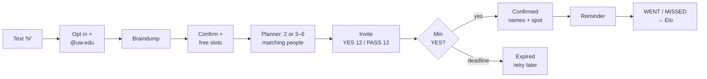
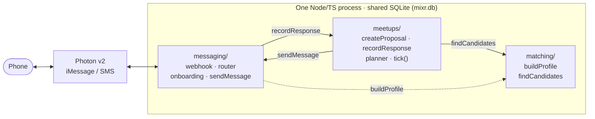

# mixr

**A campus organizer you can text.** Text mixr what you're into. It finds other UW students who want the same thing, proposes a specific time and public place, and confirms the meetup once enough people say yes. Nobody has to make flyers or herd a group chat.

> Most matching apps stop at "you two should hang out sometime." mixr does the organizing work after that: availability, minimum headcount, cancellations, reminders, and follow-up.

## How it works



## Architecture



- **Matching** = hard filters (availability, mode, opted-in, not busy) → cosine similarity over **one vector per interest**, so a philosophy + soccer person can join either group → greedy group selection against a running centroid.
- **Event vectors learn:** each time someone accepts, the meetup's embedding moves toward the average of the people who said yes (`0.5·seed + 0.5·mean(accepted)`).
- **Reliability** is an Elo rating: WENT raises it and MISSED lowers it. It slightly weights candidate ranking.
- Similarity **ranks** candidates. It is not a "personality compatibility" score.

## Stack

| Concern | Choice | Why |
|---|---|---|
| Runtime | Node ≥ 24, TypeScript via native type-stripping | No build step |
| DB | `node:sqlite`, one file | 1,000 users × 384 floats ≈ 1.5 MB. No server needed |
| Tests | `node:test` | Built in |
| Messaging | Photon v2 (iMessage/SMS) | Hackathon track fit |
| Extraction | `@anthropic-ai/sdk`, `claude-haiku-5-5` | Braindump → structured profile |
| Embeddings | `@huggingface/transformers`, `all-MiniLM-L6-v2` | Local, free, 384-dim |

## Run it

```bash
npm install
cp .env.example .env      # fill in keys
npm test                  # all tests, in-memory DB, fake LLM
npm run chat              # local multi-phone REPL (/as +1555..., /tick), no Photon needed
npm run seed -- 1000      # synthetic users + matching benchmark
npm start                 # server: POST /webhook/photon, GET /health
```

## Privacy & consent

- **Opt-in only.** Students join via a shared number or QR code. We don't scrape the UW directory: it prohibits commercial use and it's a spam/legal risk.
- Phone numbers are never shared. Confirmations show first names only.
- Reply `STOP` anytime and it's honored instantly.
- A verified `@uw.edu` email proves access to that address, not current enrollment.

## Limitations

- Messaging capacity per Photon line: _TBD_
- `findCandidates` p95 at 1,000 users: _TBD_
- Prior art: Ditto, lowkey, Timeleft, 222, and Husky Social all do matching. mixr's difference is **completing the meetup**.

## Contributing

See [PLAN.md](PLAN.md).
