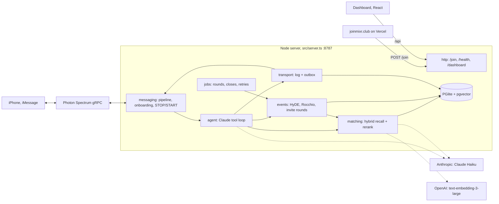
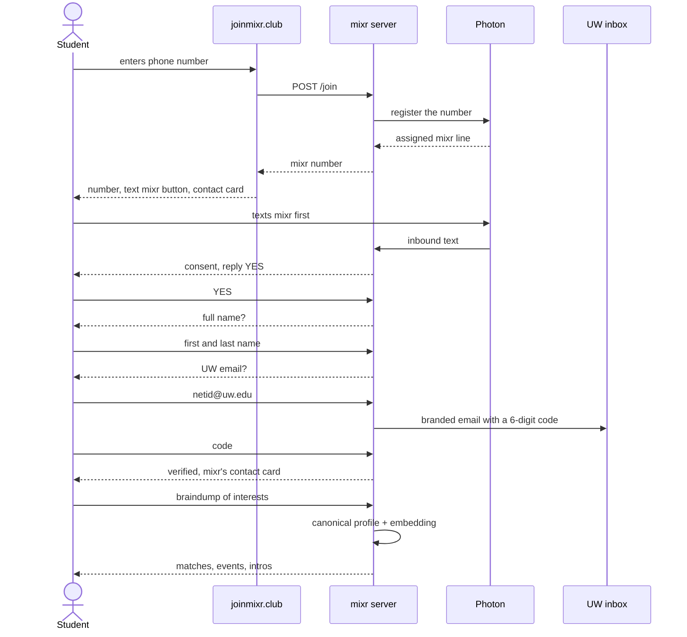
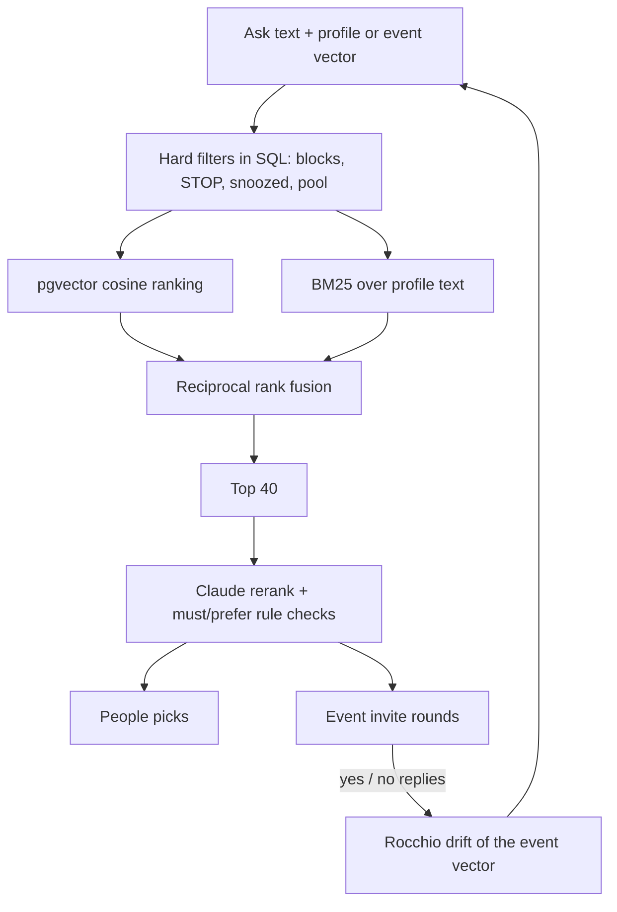

<a id="readme-top"></a>

<!-- PROJECT SHIELDS -->
[![Contributors][contributors-shield]][contributors-url]
[![Forks][forks-shield]][forks-url]
[![Stargazers][stars-shield]][stars-url]
[![Issues][issues-shield]][issues-url]

<!-- PROJECT LOGO -->
<br />
<div align="center">
  <a href="https://github.com/Nano-AI/mixr">
    
  </a>

  <h3 align="center">mixr</h3>

  <p align="center">
    The campus organizer you text. Say what you're into; it finds your people and plans the meetup.
    <br />
    <a href="docs/spec.md"><strong>Read the design spec »</strong></a>
    <br />
    <br />
    <a href="https://joinmixr.club">Try it</a>
    &middot;
    <a href="https://joinmixr.club">View demo</a>
    &middot;
    <a href="https://github.com/Nano-AI/mixr/issues/new?labels=bug&template=bug-report---.md">Report bug</a>
    &middot;
    <a href="https://github.com/Nano-AI/mixr/issues/new?labels=enhancement&template=feature-request---.md">Request feature</a>
  </p>
</div>

<!-- TABLE OF CONTENTS -->
<details>
  <summary>Table of contents</summary>
  <ol>
    <li>
      <a href="#about-the-project">About the project</a>
      <ul>
        <li><a href="#features">Features</a></li>
        <li><a href="#architecture">Architecture</a></li>
        <li><a href="#photon-version-note-for-reviewers">Photon version</a></li>
        <li><a href="#privacy-and-consent">Privacy and consent</a></li>
        <li><a href="#built-with">Built with</a></li>
      </ul>
    </li>
    <li>
      <a href="#getting-started">Getting started</a>
      <ul>
        <li><a href="#prerequisites">Prerequisites</a></li>
        <li><a href="#installation">Installation</a></li>
      </ul>
    </li>
    <li>
      <a href="#usage">Usage</a>
      <ul>
        <li><a href="#how-people-join">How people join</a></li>
        <li><a href="#how-matching-works">How matching works</a></li>
        <li><a href="#the-dashboard">The dashboard</a></li>
        <li><a href="#scripts">Scripts</a></li>
        <li><a href="#deploy">Deploy</a></li>
      </ul>
    </li>
    <li><a href="#roadmap">Roadmap</a></li>
    <li><a href="#contributing">Contributing</a></li>
    <li><a href="#license">License</a></li>
    <li><a href="#contact">Contact</a></li>
    <li><a href="#acknowledgments">Acknowledgments</a></li>
  </ol>
</details>


<!-- ABOUT THE PROJECT -->
## About the project

[![mixr cover][product-cover]](https://joinmixr.club)

mixr is an iMessage agent for University of Washington students. You text it what you're into, in plain words. It finds people who'd click, gets you into events other students host, and learns from what you say yes to. There are no forms and no app to install: sign up at [joinmixr.club](https://joinmixr.club), then everything happens over iMessage.

[![joinmixr.club landing page][product-screenshot]](https://joinmixr.club)

The landing page plays a sample conversation, then asks for your number and hands you your own mixr line to text.

### Features

* **iMessage agent on Photon Spectrum.** Texts arrive over Photon's gRPC event stream; replies go out through a durable outbox with retries and dedupe.
* **Onboarding without the LLM.** Consent (reply YES), then full name, then an @uw.edu email and a 6-digit code. The code arrives in a branded HTML email with a plain-text alternative.
* **Claude Haiku tool-calling agent.** After verification the agent takes a braindump, keeps the profile current, finds people, hosts and joins events, and handles intros. Read-only tool calls in one turn run in parallel.
* **Hybrid matching.** pgvector recall plus BM25, fused with reciprocal rank fusion, then a Claude rerank. Blocks and special requests are enforced in code before ranking.
* **Events.** Students host events by text. mixr seeds a target profile with HyDE, drifts it toward the people who say yes (Rocchio), and invites in hidden rounds until the event fills.
* **Intros with double opt-in.** A number is shared only when both people agree, and each side gets the other's contact card.
* **Native iMessage touches.** mixr's contact card after verification, Share Name and Photo, confetti on a confirmed seat, tapbacks instead of filler replies, inline replies that thread, and a joinmixr.club link preview on HELP.
* **Per-person rate limit.** 30 texts an hour. One notice, then quiet until the hour rolls over. STOP, START and HELP always work.
* **React dashboard.** Act as any user, watch matching traces, see every profile on a 2D vector map, and fast-forward the demo clock.
* **Eval harness.** `npm run eval` compares two revisions on retrieval, reply quality, latency and tokens.

<p align="right">(<a href="#readme-top">back to top</a>)</p>

### Architecture

One Node 24 process on polarcrest with an embedded Postgres (PGlite + pgvector). Texts arrive over Photon's event stream; everything else runs in one server.



![Under the hood: one Node process, one embedded Postgres][under-the-hood]

* **Two pools that never meet.** *Demo*: the 50 seeded students plus numbers created in the dashboard, on a simulated clock you fast-forward; nothing is ever delivered. *Real*: people who joined through the website, on wall-clock time, delivered over iMessage.
* **Models.** Claude `claude-haiku-5-5` for the agent and the matching pipeline, with a daily cap (`CLAUDE_DAILY_REQUEST_LIMIT`, default 1000). OpenAI `text-embedding-3-large` for embeddings only, cached by text.
* **Code map.** `src/messaging/` (Photon, inbound pipeline, onboarding), `src/agent/`, `src/matching/`, `src/events/`, `src/relay/` (intros), `src/requirements/` (blocks and special requests), `src/profiles/`, `src/transport/`, `src/jobs/`, `src/http/`, `src/db/`. Outside `src/`: `web/` (dashboard), `landing/` (joinmixr.club), `scripts/`, `deploy/`, `test/`, `fixtures/`. The full map is in [CONTRIBUTING.md](CONTRIBUTING.md).

<p align="right">(<a href="#readme-top">back to top</a>)</p>

### Photon version (note for reviewers)

mixr is built on **Photon 2.0 (Spectrum)**, the version the DubHacks Photon track requires ("must be built on Photon 2.0 and live on at least one Photon channel"). In the code:

* `spectrum-ts` 12.11 with its iMessage provider: `core.Spectrum({ projectId, projectSecret, providers: [imessage.config()] })` in [`src/messaging/photon.ts`](src/messaging/photon.ts).
* Sign-ups go through the Spectrum REST API (`https://spectrum.photon.codes`, project-scoped Basic auth) in [`src/messaging/photon-api.ts`](src/messaging/photon-api.ts), which registers each number on the project's shared iMessage line.
* Nothing uses the Photon 1.0 iMessage SDK directly or a 1.0 line's address and token.

The constraint we ran into: Photon 2.0 Free allows **10 registered users per project** (Pro: 100). During the hackathon, Photon's sponsor team answered our "we need more than 10 people" question by offering a free month of a **Photon 1.0 iMessage Pro line** (promo code `HACKWITHPHOTON`). That offer applies to Photon 1.0, not 2.0, so we did not switch: moving to 1.0 would take mixr off the version the track is judged on. We stayed on 2.0 and kept the 10-user cap for the live pilot. The 50 demo students in the dashboard run in a separate pool that never sends a real text and uses no Photon slots.

If mixr needs more than 10 real users, the path is a Photon 2.0 Pro plan on the same project (no code change). A 1.0 Pro line is the fallback if 2.0 Pro isn't available: Spectrum's iMessage provider can also take a dedicated line's address and token, which would be a config change in `src/messaging/photon.ts`.

### Privacy and consent

* Opt-in only: people join through the site and text first. mixr never texts first. No directory scraping.
* Texts to other people use first names. A full name and phone number are shared only when both sides of an intro agree.
* `STOP` is honored immediately and suppresses anything queued. `START` resumes.
* A verified @uw.edu email proves inbox access, not enrollment. Codes are hashed, never stored or logged.
* Blocks and special requests are enforced in code before ranking. No filtering by gender or protected traits.

<p align="right">(<a href="#readme-top">back to top</a>)</p>

### Built with

* [![TypeScript][TypeScript]][TypeScript-url]
* [![Node.js][Node.js]][Node-url]
* [![Hono][Hono]][Hono-url]
* [![PGlite][PGlite]][PGlite-url]
* [![pgvector][pgvector]][pgvector-url]
* [![Anthropic Claude][Claude]][Claude-url]
* [![OpenAI][OpenAI]][OpenAI-url]
* [![Photon iMessage][Photon]][Photon-url]
* [![React][React.js]][React-url]
* [![Vite][Vite]][Vite-url]
* [![Vitest][Vitest]][Vitest-url]
* [![anime.js][animejs]][animejs-url]
* [![WebGL][WebGL]][WebGL-url]
* [![Vercel][Vercel]][Vercel-url]
* [![Cloudflare][Cloudflare]][Cloudflare-url]

<p align="right">(<a href="#readme-top">back to top</a>)</p>


<!-- GETTING STARTED -->
## Getting started

You can run all of mixr on a laptop with no iMessage at all: `TRANSPORT=sim` keeps delivery inside the dashboard, and `MIXR_FAKE=1` swaps in a fake LLM and fake embeddings so no keys are needed.

### Prerequisites

* Node 24 (see `.nvmrc`)
  ```sh
  nvm use
  ```
* Python 3, only to serve the landing page locally
* Optional keys, depending on what you want to run:
  * `ANTHROPIC_API_KEY` for the agent and the matching pipeline
  * `OPENAI_API_KEY` for embeddings
  * `PROJECT_ID` and `PROJECT_SECRET` for Photon iMessage (production only)
  * `GMAIL_USER` and `GMAIL_APP_PASSWORD`, or `RESEND_API_KEY` and `EMAIL_FROM`, for UW email codes

### Installation

1. Clone the repo
   ```sh
   git clone https://github.com/Nano-AI/mixr.git
   cd mixr
   ```
2. Install the server and dashboard packages
   ```sh
   npm install && (cd web && npm install)
   ```
3. Create your env file and set only what you need
   ```sh
   cp .env.example .env
   ```
   | Setting | What it does |
   |---|---|
   | `MIXR_FAKE=1` | Fully offline: fake LLM and embeddings, no keys. |
   | `TRANSPORT=sim` | Keep this locally (`.env.example` says `photon`). Nothing is delivered; you text as anyone from the dashboard. |
   | `PIPELINE_LLM=off` | The agent stays on Claude; matching becomes vector-only. |
   | `ANTHROPIC_MODEL`, `CLAUDE_DAILY_REQUEST_LIMIT` | Model for the agent and pipeline, and the hard daily cap on requests. |
   | `EMBEDDING_MODEL`, `EMBEDDING_DIMS` | OpenAI embedding model and vector size. |
   | `EMAIL_PROVIDER` | `gmail` or `resend` for verification codes. |
   | `JOIN_ORIGINS` | CORS origins allowed to call `POST /join`. |
   | `DEV_JOIN_NUMBER` | With `TRANSPORT=sim`, the number `/join` hands out. |
   | `ADMIN_TOKEN` | Dashboard login. Optional locally, required in production. |
   | `PORT`, `HOST`, `DB_DIR`, `PUBLIC_URL`, `TZ` | Runtime settings. |
4. Seed the 50 demo students (embeddings only, cached by text; free with `MIXR_FAKE=1`)
   ```sh
   npm run seed
   ```
5. Start the server and dashboard
   ```sh
   npm run dev   # server http://localhost:8787 + dashboard http://localhost:5173
   ```
6. Optionally serve the landing page; add `?mock=ok` to click through without a server
   ```sh
   python3 -m http.server -d landing 4321
   ```
7. Run the tests, which are offline (fake LLM and embeddings, in-memory DB)
   ```sh
   npm test
   npm run typecheck
   (cd web && npx tsc --noEmit)
   ```

PGlite allows one process per database, so run `npm run seed` while `npm run dev` is stopped, or press **Seed** in the dashboard's top bar.

<p align="right">(<a href="#readme-top">back to top</a>)</p>


<!-- USAGE EXAMPLES -->
## Usage

![How it works: say what you're into, it finds your people and plans the meetup][how-it-works]

Once someone is verified, they just text. "pickup soccer mostly, also need people to study for 332 with" becomes a profile. mixr finds people into the same thing, proposes a real time and a public campus place, and confirms once enough people say yes. Students can also host their own events by text, and mixr fills them.

### How people join

1. On [joinmixr.club](https://joinmixr.club) they enter their phone number. The server registers it with Photon (iMessage shared line), which assigns them their own mixr number.
2. The site shows that number with a "text mixr" button and a contact card. They text first; mixr never texts first.
3. Over iMessage: opt in with YES, then full name, then @uw.edu email, then the 6-digit code. After that the agent takes the braindump.



Photon Free allows 10 registered users per project (Pro: 100). Every number entered on the site uses a slot, so don't test `/join` in production with throwaway numbers.

<p align="right">(<a href="#readme-top">back to top</a>)</p>

### How matching works

Every person is one vector: the embedding of their canonical profile text. People searches and event invites go through the same pipeline.



* **Recall.** pgvector cosine over active users, plus BM25 over the same rows when there is ask text, fused with RRF (k = 60). BM25 catches exact terms embeddings blur, like course numbers or ratings. It runs in process today; past about 10k users it should move to SQL full-text.
* **Hard filters.** Blocks, people who texted STOP, snoozed users and the other pool are removed in SQL before ranking, so the reranker never sees them.
* **Rerank.** Claude orders the top 40 and returns a pass/fail/unknown verdict for each special request. Code keeps only explicit passes on `must` rules and orders by `prefer` passes. With `PIPELINE_LLM=off` the vector order is used.
* **Events.** The first round recalls on a HyDE target profile written from the event. Each later round recalls on the drifted vector plus an exploration buffer on the original, sizes itself from the observed yes-rate, and stops an hour before start.

<p align="right">(<a href="#readme-top">back to top</a>)</p>

### The dashboard

At `/dashboard` (login with `ADMIN_TOKEN`). Tabs for events, users, traces and a 2D map of every profile vector. You can open a phone pane and act as any user, inspect each matching step, and fast-forward the demo clock. Acting as a real user keeps mixr's replies to them in the dashboard and sends nothing to their phone; everything else is real. `POST /api/admin/send` sends an operator message to one real user and returns the delivery record.

### Scripts

| Command | What it does |
|---|---|
| `npm run dev` | Server with reload plus the dashboard dev server. |
| `npm start` | Production server. |
| `npm run seed` | Seed the 50 demo students from `fixtures/seed-users.json`. |
| `npm run eval -- --base origin/main --head HEAD` | Check out both revisions into temporary worktrees, run each against its own throwaway DB, and write a before/after report on retrieval, reply quality, latency and tokens to `scripts/eval/out/report.md`. Keys come from `.env.eval`, never `.env`; `--offline` uses fakes. |
| `node --import tsx scripts/reset-real.ts --yes` | Delete every real user from the DB and every registration on the Photon project. Demo users stay. Stop the server first. |
| `node --import tsx scripts/delete-user.ts +15555550123 --yes` | Delete one real user and their data from the DB. Photon is untouched. Stop the server first. |

### Deploy

Merging to `main` deploys it. Every 2 minutes `mixr-autodeploy.timer` on polarcrest checks main for a new commit, runs the tests, typecheck and dashboard build on the box, and only then switches releases and restarts. If `/health` doesn't answer within 45s it goes back to the previous release. A failing commit never goes live. CI (`.github/workflows/ci.yml`) runs the same checks on every PR. Vercel deploys `landing/` from `main` to joinmixr.club.

```sh
scripts/deploy.sh               # deploy main now (also installs/updates auto-deploy)
scripts/deploy.sh integration   # another branch; auto-deploy leaves it up until main gets a new commit
scripts/deploy.sh --rollback    # previous release; auto-deploy waits for the next commit on main
FORCE=1 scripts/deploy.sh       # rebuild a live commit or retry a failed one
```

* **Releases.** `deploy/release.sh` builds tarball releases in `~/mixr-releases` (3 kept); `~/mixr` points at the live one. History: `~/mixr-data/deploys.log`. Pause auto-deploy with `touch ~/mixr-data/autodeploy.paused`.
* **systemd.** User service `mixr` (`deploy/mixr.service`): `Restart=always`, starts at boot (lingering), 4 GB cap. `mixr-health.timer` restarts it if `/health` fails twice.
* **Data and secrets.** Secrets in `~/mixr-data/mixr.env` (mode 600, never in git). Database in `~/mixr-data/pglite`. Nightly snapshots in `~/mixr-data/backups` (7 kept). Deploys never touch `~/mixr-data`.
* **Logs.** `journalctl --user -u mixr -f`, and `journalctl --user -u mixr-autodeploy` for auto-deploy.
* **Public URL.** `https://api.joinmixr.club`, a Cloudflare for SaaS custom hostname that routes through the Cloudflare tunnel to `localhost:8787`.
* **Later.** Railway is an option ([docs/deploy/railway.md](docs/deploy/railway.md)); today it's the monolith.
* **Schema changes stay additive.** A rollback runs older code on the same database.

<p align="right">(<a href="#readme-top">back to top</a>)</p>


<!-- ROADMAP -->
## Roadmap

- [x] iMessage over Photon Spectrum, with a durable outbox, retries and dedupe
- [x] Website signup that assigns each person their own mixr line
- [x] Onboarding: consent, full name, @uw.edu email code
- [x] Branded HTML verification email
- [x] Claude Haiku tool-calling agent with a daily request cap
- [x] Hybrid matching: pgvector + BM25, RRF, Claude rerank
- [x] Blocks and special requests enforced before ranking
- [x] Hosted events with HyDE seeding, Rocchio drift and hidden invite rounds
- [x] Intros with double opt-in and contact cards
- [x] Native iMessage touches: contact cards, confetti, tapbacks, link previews, inline replies
- [x] Per-person rate limit of 30 texts an hour
- [x] React dashboard with traces and a vector map
- [x] `npm run eval` before/after harness
- [x] Auto-deploy from `main` with tests as the gate and automatic rollback
- [ ] Resend sending domain for verification email
- [ ] Polls
- [ ] Rolling conversation summaries for long-time users
- [ ] Photon 2.0 Pro plan to go past 10 real users (see "Photon version" above)
- [ ] BM25 at scale: SQL full-text past about 10k users
- [ ] Test verification email delivery to Outlook inboxes
- [ ] Live multi-phone run-through
- [ ] Calendar sync
- [ ] Voice braindumps
- [ ] Native group chats for confirmed events

See the [open issues](https://github.com/Nano-AI/mixr/issues) for the full list of proposed features and known issues.

<p align="right">(<a href="#readme-top">back to top</a>)</p>


<!-- CONTRIBUTING -->
## Contributing

Contributions are welcome. `main` deploys itself to production, so every change goes through a pull request.

1. Branch off `main` (`git checkout -b feature/your-change`)
2. Make your change. Keep tests offline: never call real Claude, OpenAI or Photon from a test; use `MIXR_FAKE` and injected fetches.
3. Run `npm test`, `npm run typecheck` and `(cd web && npx tsc --noEmit)`
4. Commit and push your branch (`git push origin feature/your-change`)
5. Open a pull request. CI must pass.
6. Once merged, polarcrest picks up the new commit on `main` within about 2 minutes, runs the checks on the box and goes live, or rolls back if `/health` fails.

Never commit secrets, and keep schema changes additive. The full workflow and ops cheatsheet are in [CONTRIBUTING.md](CONTRIBUTING.md).

### Top contributors

<a href="https://github.com/Nano-AI/mixr/graphs/contributors">
  
</a>

<p align="right">(<a href="#readme-top">back to top</a>)</p>


<!-- LICENSE -->
## License

No license yet; all rights reserved by the authors.

<p align="right">(<a href="#readme-top">back to top</a>)</p>


<!-- CONTACT -->
## Contact

mixr team: [hello@joinmixr.club](mailto:hello@joinmixr.club)

Website: [https://joinmixr.club](https://joinmixr.club)

Project link: [https://github.com/Nano-AI/mixr](https://github.com/Nano-AI/mixr)

<p align="right">(<a href="#readme-top">back to top</a>)</p>


<!-- ACKNOWLEDGMENTS -->
## Acknowledgments

* [Photon](https://photon.codes) for Spectrum and iMessage lines
* [DubHacks '26](https://dubhacks.co), where mixr was built
* [Anthropic](https://www.anthropic.com) for Claude
* [OpenAI](https://openai.com) for embeddings
* [PGlite](https://pglite.dev) for embedded Postgres with pgvector
* [anime.js](https://animejs.com) for the landing page animation
* [Best-README-Template](https://github.com/othneildrew/Best-README-Template), the layout this README follows
* [shields.io](https://shields.io)
* [contrib.rocks](https://contrib.rocks)

<p align="right">(<a href="#readme-top">back to top</a>)</p>


<!-- MARKDOWN LINKS & IMAGES -->
[contributors-shield]: https://img.shields.io/github/contributors/Nano-AI/mixr.svg?style=for-the-badge
[contributors-url]: https://github.com/Nano-AI/mixr/graphs/contributors
[forks-shield]: https://img.shields.io/github/forks/Nano-AI/mixr.svg?style=for-the-badge
[forks-url]: https://github.com/Nano-AI/mixr/network/members
[stars-shield]: https://img.shields.io/github/stars/Nano-AI/mixr.svg?style=for-the-badge
[stars-url]: https://github.com/Nano-AI/mixr/stargazers
[issues-shield]: https://img.shields.io/github/issues/Nano-AI/mixr.svg?style=for-the-badge
[issues-url]: https://github.com/Nano-AI/mixr/issues
[product-cover]: docs/images/01-cover.jpg
[how-it-works]: docs/images/02-how-it-works.jpg
[under-the-hood]: docs/images/03-under-the-hood.jpg
[product-screenshot]: docs/images/04-landing.jpg
[TypeScript]: https://img.shields.io/badge/TypeScript-3178C6?style=for-the-badge&logo=typescript&logoColor=white
[TypeScript-url]: https://www.typescriptlang.org
[Node.js]: https://img.shields.io/badge/Node.js-5FA04E?style=for-the-badge&logo=nodedotjs&logoColor=white
[Node-url]: https://nodejs.org
[Hono]: https://img.shields.io/badge/Hono-E36002?style=for-the-badge&logo=hono&logoColor=white
[Hono-url]: https://hono.dev
[PGlite]: https://img.shields.io/badge/PostgreSQL%20%28PGlite%29-4169E1?style=for-the-badge&logo=postgresql&logoColor=white
[PGlite-url]: https://pglite.dev
[pgvector]: https://img.shields.io/badge/pgvector-336791?style=for-the-badge&logo=postgresql&logoColor=white
[pgvector-url]: https://github.com/pgvector/pgvector
[Claude]: https://img.shields.io/badge/Anthropic%20Claude-191919?style=for-the-badge&logo=anthropic&logoColor=white
[Claude-url]: https://www.anthropic.com/claude
[OpenAI]: https://img.shields.io/badge/OpenAI-412991?style=for-the-badge&logo=openai&logoColor=white
[OpenAI-url]: https://platform.openai.com
[Photon]: https://img.shields.io/badge/Photon%20iMessage-34C759?style=for-the-badge&logo=imessage&logoColor=white
[Photon-url]: https://photon.codes
[React.js]: https://img.shields.io/badge/React-20232A?style=for-the-badge&logo=react&logoColor=61DAFB
[React-url]: https://react.dev
[Vite]: https://img.shields.io/badge/Vite-646CFF?style=for-the-badge&logo=vite&logoColor=white
[Vite-url]: https://vite.dev
[Vitest]: https://img.shields.io/badge/Vitest-6E9F18?style=for-the-badge&logo=vitest&logoColor=white
[Vitest-url]: https://vitest.dev
[animejs]: https://img.shields.io/badge/anime.js-FF4B4B?style=for-the-badge
[animejs-url]: https://animejs.com
[WebGL]: https://img.shields.io/badge/WebGL-990000?style=for-the-badge&logo=webgl&logoColor=white
[WebGL-url]: https://www.khronos.org/webgl/
[Vercel]: https://img.shields.io/badge/Vercel-000000?style=for-the-badge&logo=vercel&logoColor=white
[Vercel-url]: https://vercel.com
[Cloudflare]: https://img.shields.io/badge/Cloudflare-F38020?style=for-the-badge&logo=cloudflare&logoColor=white
[Cloudflare-url]: https://www.cloudflare.com
